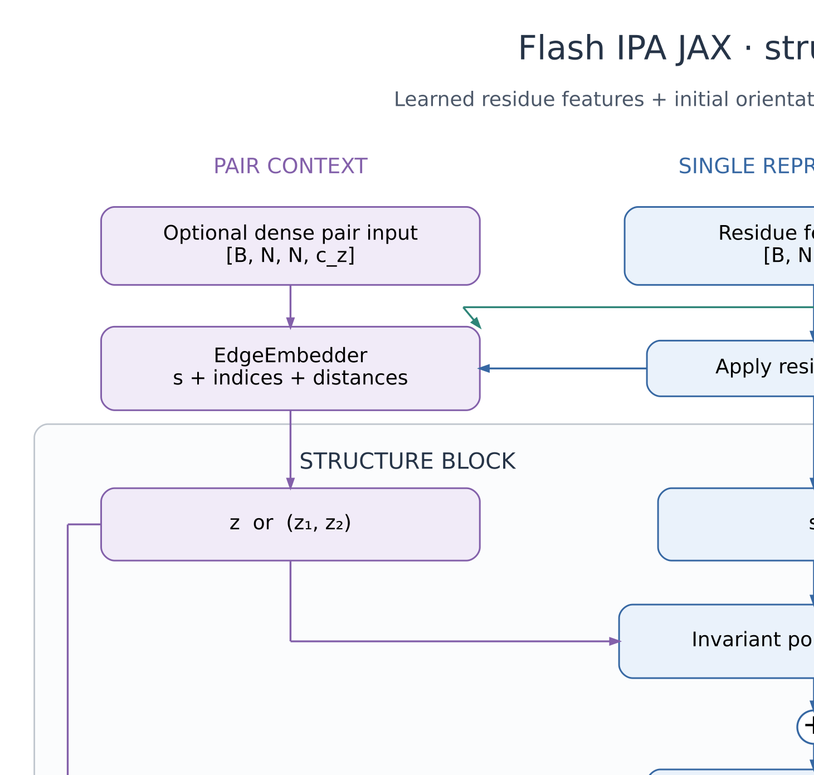

# FlashIPA in JAX

Geometry-aware attention for protein, RNA and other models that represent
objects using local 3D coordinate systems. This is a pure JAX port of
[FlashIPA](https://github.com/flagshippioneering/flash_ipa), with readable
layer and model APIs, rigid-body geometry, edge embeddings and training examples.
PyTorch and Flax are not required.

**Invariant Point Attention (IPA)** lets a residue attend to other residues using
both learned features and distances between learned 3D points. Rotating or moving
the whole molecule leaves the output features unchanged. **FlashAttention**
computes attention in small tiles to avoid storing the full attention matrix.
FlashIPA rewrites geometric and factorized pair terms so compatible fused
FlashAttention kernels can evaluate them. Start with the explanation in
[Concepts](docs/CONCEPTS.md) and the [papers](docs/REFERENCES.md).

## Architecture at a glance



The model builds pair context, refines residue features with IPA and sequence
attention, then updates residue orientations and positions over repeated blocks. The
[architecture guide](docs/architecture.md) explains each stage, the attention
backend choices, and where the implementation lives.

## Install and try it

```bash
python3 -m venv .venv
source .venv/bin/activate
python -m pip install -e '.[test]'
python examples/minimal.py
python examples/train.py --backend native --steps 30
python -m pytest -q
```

The package requires Python >= 3.11 and JAX >= 0.7.1. Choose a JAX release that
supports your Python version and accelerator. Install the appropriate device
build using the [official JAX guide](https://docs.jax.dev/en/latest/installation.html).
Optional GPU kernel packages are installed separately; see [Backends](docs/BACKENDS.md).

## Choose a backend

| Backend name | How attention runs | Where to start |
| --- | --- | --- |
| `native` | Pure JAX, including query/key tiling with online softmax | CPU, TPU, supported GPUs; all pair modes and masks |
| `flash_attn3` | Factorized geometric attention packed for the FA3 JAX binding | Supported NVIDIA Hopper GPU; FP16/BF16; expanded widths <= 128 |
| `jax_aiter` | The same packing with AMD's JAX-AITER attention | Inspected gfx950/MI355X stack; FP16/BF16; expanded widths <= 256 |

All three paths preserve scalar, geometric and supported pair contributions.
The native FlashAttention algorithm is portable JAX code; performance depends on
XLA and the device. The two GPU paths call external fused kernels.

```bash
# A complete optimizer loop for each backend. --strict requires that GPU kernel.
python examples/train.py --backend native --steps 30
python examples/train.py --backend flash_attn3 --strict --steps 30
python examples/train.py --backend jax_aiter --strict --steps 30
```

Omit `--strict` to allow native fallback. Examples print the **requested and
selected backend**, together with the reason. Explicit masks, dense pair terms,
unsupported hardware or unsupported dimensions select native execution. Keep
`--strict` when validating GPU installation or recording GPU benchmarks.

## A small IPA layer

```python
import jax
import jax.numpy as jnp
from flash_ipa_jax import BackendConfig, IPAConfig, InvariantPointAttention

# c_hidden is the scalar width PER HEAD, not the total hidden width.
config = IPAConfig(c_s=64, c_z=0, c_hidden=16, no_heads=4,
                   no_qk_points=4, no_v_points=8, pair_mode="none")
layer = InvariantPointAttention(config, BackendConfig(name="native"))
params = layer.init(jax.random.key(0))

single = jax.random.normal(jax.random.key(1), (1, 32, 64))
rotations = jnp.broadcast_to(jnp.eye(3), (1, 32, 3, 3))
translations = jnp.zeros((1, 32, 3))
update = jax.jit(layer.apply)(params, single, rotations, translations)
updated_single = single + update  # IPA returns an update for a residual block.
```

A new layer's output projection is zero, matching upstream initialization.
Its first update is therefore zero. Training with a nonzero target trains that
projection first. Use `zero_init_output=False` in `init` for diagnostics.

## Documentation index

The [documentation index](docs/README.md) gives a suggested reading order.

| Goal | Guide |
| --- | --- |
| Understand IPA, FlashAttention, applications and JAX | [Concepts](docs/CONCEPTS.md) |
| Follow the model and attention data flow; locate the source | [Architecture and generated figures](docs/architecture.md) |
| Use layers, pair features, masks or the full structure model | [Usage and shapes](docs/USAGE.md) |
| Run training; choose dimensions, learning rates and losses | [Training](docs/TRAINING.md) |
| Understand XLA, TPUs, accelerator support and fallback | [Backends](docs/BACKENDS.md) |
| Extend a fused kernel or measure performance | [Kernel integration](docs/KERNEL_INTEGRATION.md) |
| Compare this port with upstream files and behavior | [Upstream coverage](docs/UPSTREAM.md) |
| Find papers and source references | [References](docs/REFERENCES.md) |
| See executed checks and remaining hardware validation | [Validation record](VALIDATION.md) |

## Examples and development

| Entry point | What to run or read |
| --- | --- |
| [Examples index](examples/README.md) | Commands and options for all three backend names |
| [Minimal IPA example](examples/minimal.py) | One layer and its parameter gradients |
| [Layer training loop](examples/train.py) | Pure JAX Adam fitting a fixed teacher |
| [Structure-model training loop](examples/structure_model.py) | Complete model with toy structure-denoising updates |
| [Benchmark harness](benchmarks/benchmark.py) | Synchronized forward/backward timings with actual dispatch |
| [Benchmark results](benchmarks/results/) | Recorded CPU smoke measurements |
| [Tests](tests/) | Numerical references, geometry, model, backend and training checks |
| [CPU workflow](.github/workflows/tests.yml) | Automated test and example commands |
| [Model architecture SVG](docs/figures/architecture.svg) / [PNG](docs/figures/architecture.png) | Full model diagram for viewing or reuse |
| [IPA architecture SVG](docs/figures/ipa_attention.svg) / [PNG](docs/figures/ipa_attention.png) | Attention detail and backend selection |
| [Model DOT source](docs/figures/architecture.dot) / [IPA DOT source](docs/figures/ipa_attention.dot) | Editable diagram definitions and layout |
| [Figure generator](docs/figures/generate_architecture.py) | Render SVG/PNG with Python and the Graphviz `neato` command |

```bash
# Tests and code formatting; the dev extra supplies Black.
python -m pip install -e '.[dev]'
python -m pytest -q
python -m black --check src tests examples benchmarks docs/figures

# Optional: regenerate the checked-in diagrams after installing Graphviz.
python docs/figures/generate_architecture.py
```

## Source index

| Responsibility | Implementation |
| --- | --- |
| Public imports | [Package API](src/flash_ipa_jax/__init__.py) |
| Model dimensions and IPA layer | [Configuration](src/flash_ipa_jax/config.py), [layer](src/flash_ipa_jax/layer.py) |
| Projected attention and execution selection | [Attention API](src/flash_ipa_jax/attention.py), [backends](src/flash_ipa_jax/backends.py), [kernels](src/flash_ipa_jax/kernels/) |
| Complete model and update blocks | [Model](src/flash_ipa_jax/model.py), [structure blocks](src/flash_ipa_jax/structure/) |
| Pair context | [Edge embedder](src/flash_ipa_jax/edge_embedder.py), [factorizer](src/flash_ipa_jax/factorizer.py) |
| Coordinate systems and rotations | [Geometry](src/flash_ipa_jax/geometry/) |
| Shared learned operations | [Linear projections](src/flash_ipa_jax/linear.py), [normalization](src/flash_ipa_jax/normalization.py), [IPA projection shapes](src/flash_ipa_jax/projections.py) |
| Features and checkpoint loading | [Utilities](src/flash_ipa_jax/utils.py), [IPA checkpoint conversion](src/flash_ipa_jax/checkpoint.py) |

Each Python module is at most 300 lines. Import model/layer classes from
`flash_ipa_jax`, and geometry helpers from `flash_ipa_jax.geometry`. The unused
`flash_ipa_jax.rigid` and `flash_ipa_jax.ipa` re-export wrappers have been removed.
The actual rigid-transformation implementation remains in `geometry/rigid.py`.

CPU correctness, optimization examples and hardware guard tests are separate
from real GPU/TPU validation. No GPU speedup, complete trained-checkpoint parity
or production biomolecular model quality is claimed. See the current
[validation record](VALIDATION.md) for precisely what was run.

This port retains upstream MIT attribution in [NOTICE](NOTICE) and [LICENSE](LICENSE).
External kernel libraries retain their own licenses.
