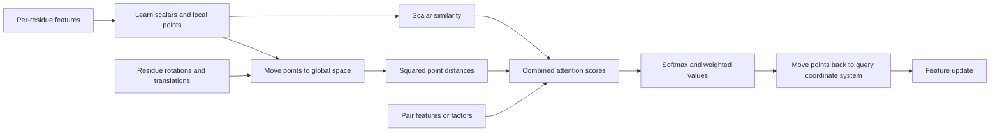

# IPA and FlashAttention, step by step

## What is IPA?

Attention chooses how much information one item should receive from other items. Ordinary attention uses learned feature vectors to make that choice. **Invariant Point Attention**, introduced in AlphaFold2, also uses geometry:
each residue predicts query, key and value points in its own local coordinate system. A rotation describes the coordinate system's orientation, and a translation locates its origin. Together they move points into a shared 3D coordinate system, where distances can be compared. [AlphaFold2 paper](https://www.nature.com/articles/s41586-021-03819-2).

For example, two amino acids can be far apart in the sequence but close together in the folded protein. IPA can use this closeness when deciding which information to exchange. Its attention score combines three contributions:

1. Similarity between scalar query and key features.
2. A penalty for large squared distances between query and key points.
3. An optional learned pair contribution for that residue pair.

The resulting attention weights combine scalar values, point values and pair values. Aggregated points are moved back into the querying residue's local coordinate system. The output combines scalar features, local x/y/z coordinates, point lengths and pair features, followed by a learned projection.



**Invariant** means the output features stay the same if the whole input is rotated and translated together. **Equivariant** means a geometric output moves by the same rotation and translation. IPA's feature update is invariant; a structure model that predicts local orientation and position updates can be equivariant. These statements require proper rotations and consistent coordinate units.

## Where is IPA useful?

Established applications include protein structure refinement and generation, and RNA backbone modeling. The FlashIPA paper evaluates replacement of IPA in FoldFlow and RNA-FrameFlow. A similar layer can be explored for other objects represented by meaningful local 3D coordinate systems, but that needs task-specific validation. [FlashIPA paper](https://arxiv.org/abs/2505.11580).

An IPA layer by itself does not predict all atoms, define a diffusion process, or supply a training objective. The structure model in this repository combines IPA with feature transitions, sequence attention and structure refinement. Real tasks still need data preprocessing, an objective, and an evaluation procedure.

## What does FlashAttention change?

Ordinary attention often stores an `N x N` matrix of scores or probabilities. At long sequence lengths that matrix is expensive to write to and read from device memory. FlashAttention processes query/key tiles and combines partial results with a stable **online softmax**. It keeps running row maxima, normalizers and weighted-value sums instead of storing every probability.
It computes the same attention operation in exact arithmetic; floating-point rounding and reduction order can differ.[FlashAttention paper](https://arxiv.org/abs/2205.14135).

For one query row, suppose the old running state is `(m, l, u)`. For a new score tile `x` and value tile `v`, the update is:

```text
m_new = max(m, max(x))
alpha = exp(m - m_new)
p = exp(x - m_new)
l_new = alpha * l + sum(p)
u_new = alpha * u + sum(p * v)
output = u / l  # after all key tiles
```

The implementation also handles masked and empty rows without dividing by zero. Tiling reduces intermediate storage; ordinary full attention still considers all query/key pairs, so its arithmetic work remains quadratic in `N`. Faster measured scaling over a hardware range is not a linear-compute guarantee.

## How does FlashIPA fit?

Geometric scores contain squared distances. The identity
`-||Q-K||²/2 = Q·K - ||Q||²/2 - ||K||²/2` lets the implementation append point coordinates and norm terms to ordinary query/key vectors. Pair factors can be appended too. An ordinary fused attention kernel then evaluates the expanded dot products. All of those terms must be retained; see the exact [packing equations](KERNEL_INTEGRATION.md).

This reduction is exact for the selected factorized model before numerical rounding. Representing a general dense pair tensor with low-rank factors can change the model. Choosing factorized features is therefore a modeling decision, separate from choosing a backend. [FlashIPA paper](https://arxiv.org/abs/2505.11580).

## Why JAX instead of PyTorch?

This port is useful when your existing model or training system uses JAX. Parameters are ordinary dictionaries of arrays. `jax.grad` differentiates the program, `jax.jit` compiles it, and `jax.vmap` can transform compatible native functions across a batch. A framework-specific module class is optional. [JAX transformations](https://docs.jax.dev/en/latest/key-concepts.html), [JIT compilation](https://docs.jax.dev/en/latest/jit-compilation.html).

JAX's XLA compilation path also makes the portable implementation useful on TPUs. PyTorch also has an XLA integration; TPU access alone does not require switching frameworks. [OpenXLA's framework list](https://openxla.org/xla). This does not make JAX universally faster than PyTorch. The original PyTorch implementation has its own ecosystem and kernels; keeping a working PyTorch model can be the more practical choice. Compare complete training steps on your actual hardware, including compilation and memory use. This port's GPU adapters have stricter limits than the full upstream ecosystem.
