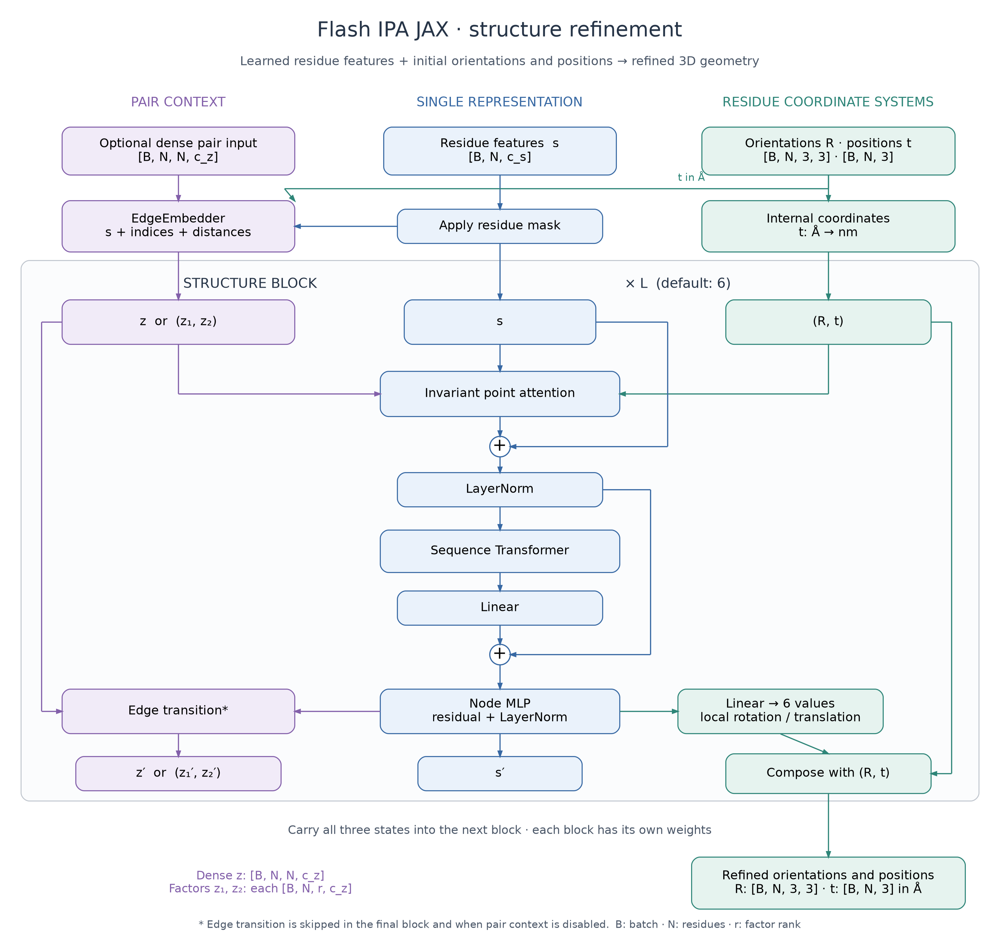
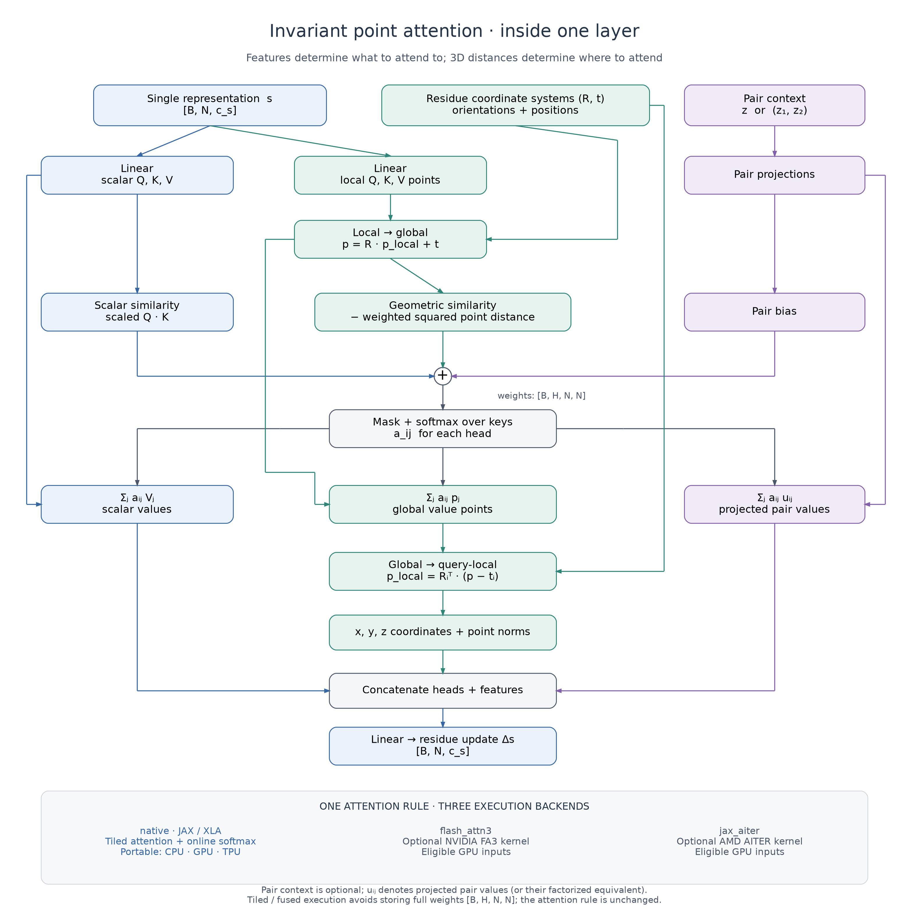

# Architecture: from residue features to refined 3D structure

This package implements the example structure network in FlashIPA using JAX.
A **residue** is one unit of a protein chain. Each residue has a **coordinate
system** described by a rotation `R` and translation `t`: `R` gives its
orientation and `t` gives its position. These are spatial axes attached to a
residue, rather than snapshots along a trajectory. The network learns to refine
these orientations and positions using residue features and their spatial
arrangement.

Use `InvariantPointAttention` for one geometry-aware feature update. Use `Model`
for the stacked network, including edge features, sequence attention and
structure refinement. Both take features and valid initial orientations and
positions supplied by your task. A sequence embedding system, atom decoder,
pretrained weights and complete folding training pipeline must come from the
surrounding application.

The diagrams use parallel representation streams, residual connections and
repeated modules, drawing on the visual organization of
[AlphaFold2 Figure 1e](https://www.nature.com/articles/s41586-021-03819-2/figures/1)
and [AlphaFold3 Figure 1d](https://www.nature.com/articles/s41586-024-07487-w/figures/1).
They show this repository's FlashIPA model; those papers describe different,
larger architectures.

## The complete model



[Download PNG](figures/architecture.png). Read from top to bottom. Blue carries
single-residue features `s`, violet carries pair context, and green carries
residue coordinate systems `(R,t)`. Matching colors follow the same information
through the network. Boxes are operations or representation tensors; circles
marked `+` are residual additions. The enclosing structure block repeats `L` times. The side paths carry pair
context and geometry into the next block. Each block has its own parameters.
`B` means batch size and `N` means the number of residues.

The model carries three kinds of information:

| State | Meaning | Shape |
| --- | --- | --- |
| Nodes `s` | One learned feature vector per residue | `[B,N,c_s]` |
| Geometry `(R,t)` | Each residue's orientation and position | `[B,N,3,3]`, `[B,N,3]` |
| Dense pairs `z`, if selected | Features for each ordered residue pair | `[B,N,N,c_z]` |
| Pair factors, if selected | Two compact arrays that represent pair context | Each `[B,N,r,c_z]` |

`r` is the factor rank. A model uses dense pairs, two factors, or no pair
features; it does not carry both dense pairs and factors through the trunk.
Factors are learned features and need not reconstruct arbitrary dense pairs.

The forward pass proceeds as follows:

1. **Prepare nodes and edges.** Padding masks zero invalid node features.
   `EdgeEmbedder` combines node features, residue indices and distance features.
   It can use optional self-conditioning positions from a previous prediction.
   Its selected mode determines the pair representation.
2. **Prepare residue coordinate systems.** Model inputs and edge distance
   features use Angstroms. Translations are then multiplied by `0.1` so IPA and
   local geometry updates operate in nanometres. Rotations are unchanged.
3. **Exchange geometric information with IPA.** Each residue attends to others
   using scalar feature similarity, 3D point distances and optional pair context.
   The update is added to the current nodes and normalized.
4. **Mix sequence features.** An ordinary sequence Transformer exchanges
   information using node features. Its output is projected and added to the
   nodes, followed by a residual node MLP and normalization.
5. **Refine orientations and positions.** A projection predicts six numbers
   per residue: three describe a local rotation update and three describe
   local translation. Composing the update with the old rigid transformation applies it in the
   residue's local coordinate system. Padded residues keep their orientation
   and position.
6. **Update pairs for the next block.** Dense edges or factors are updated from
   the new node features. This step is skipped after the final block and when
   there are no pair features. The next block receives the updated state.
7. **Return the refined structure.** `pred_trans` converts translations back to
   Angstroms; `pred_rotmats` contains the final rotation matrices. These outputs
   describe the residue coordinate systems; a downstream decoder can use them to place
   atoms.

The default configuration has six blocks, 256 node channels, 128 pair channels,
rank-two factors, and two sequence Transformer layers per block. Each IPA uses
eight heads, 128 scalar channels per head, eight query/key points and twelve
value points per head. These are this port's upstream example defaults. See
[training and published model sizes](TRAINING.md#what-sizes-did-the-original-models-use)
for the distinct AlphaFold2 dimensions and smaller runnable configurations.

## What happens inside IPA?



[Download PNG](figures/ipa_attention.png). The scalar, geometric and pair
branches show the mathematics of one IPA update. The execution inset shows
three alternative ways to run the attention core. They implement the same IPA
rule subject to the input restrictions described below; backend selection does
not add another learned layer.

The layer projects node features into scalar queries, keys and values, plus
learned 3D points. Queries describe what a residue seeks, keys describe what it
offers, and values carry information to combine. The points begin in each
residue's local coordinate system. Applying
`global_point = R @ local_point + t` puts them into one shared coordinate system.
Attention scores combine three signals:

- Scalar query/key similarity: which residues have compatible features?
- Negative squared query/key point distances: which geometric features align?
- Optional pair bias: what context is available for this residue pair?

Softmax turns the scores into weights. Those weights combine scalar values,
global value points and optional projected pair values. In the diagram, `u_ij`
means these projected values: dense inputs use `down_z(z)`, while factors supply
the corresponding query/key factor products. The attended points are then
expressed in the **query residue's local coordinate system**. Their coordinates
and lengths are concatenated with scalar and pair outputs and projected to
`[B,N,c_s]`.
This local conversion makes the feature update invariant to applying the same
proper rotation and translation to the whole structure. The updated
orientations and positions in `Model` transform with the structure, which is
called equivariance.

The layer itself returns a feature update. The larger model uses those
features to update orientations and positions. The standalone layer performs
no unit conversion: its translations must use the coordinate convention chosen
for its learned points. The full `Model` supplies the conversion described above.

## Pair representation and execution are separate choices

`ModelConfig.mode` selects how pair features are built. `BackendConfig` selects
how IPA attention runs. The historical `orig_` and `flash_` mode prefixes retain
upstream experiment names; selecting one does not force a particular backend.

| Model mode | Pair state in the repeated blocks | Preparation |
| --- | --- | --- |
| `orig_no_bias`, `flash_no_bias` | None | No edge parameters |
| `orig_2d_bias` | Dense pairs | Build or accept dense input edges |
| `flash_1d_bias` | Two factors | Build factors directly from per-residue features and nearest-neighbor distance features |
| `flash_2d_factorize_bias` | Two factors | Build or accept dense pairs, then apply learned compression; requires `max_len` |

The default native backend expresses a FlashAttention-style algorithm in JAX:
it processes query/key tiles and maintains a running softmax maximum,
denominator and weighted-value sums. It avoids materializing the complete IPA
attention matrix. JAX/XLA compiles these operations for the chosen CPU, GPU or
TPU; this implementation does not guarantee the memory placement or performance
of a tuned fused GPU kernel.

The optional `flash_attn3` and `jax_aiter` adapters pack scalar, point and
factorized pair terms into standard attention Q/K/V arrays. They call compatible
NVIDIA Hopper and AMD MI355X/gfx950 kernels respectively. Eligibility checks
include hardware, packed head width, precision and features. Explicit masks
and dense pair features select native execution. An unsupported request warns
and falls back by default; `fallback="error"` requires the requested backend.
Kernel launch errors remain visible. See [backends and accelerators](BACKENDS.md)
for exact restrictions and [kernel integration](KERNEL_INTEGRATION.md) for the
packing mathematics.

Only the IPA core uses this backend selection. The model's sequence Transformer
uses ordinary dense JAX attention, and the current nearest-neighbor search
computes dense distances. Dense pair modes also retain quadratic tensors.
Consequently, tiled or fused IPA does not make the entire structure model
linear in sequence length. Profile full forward and backward passes on your
actual accelerator.

## Why keep rigid geometry?

The implementation in [`geometry/rigid.py`](../src/flash_ipa_jax/geometry/rigid.py)
is needed: it stores residue coordinate systems, composes rigid transformations
and converts between local/global coordinates. `Rotation` handles rotation matrices and quaternions.
Both are JAX pytrees, so their array contents work with JIT and differentiation.
These operations are mathematical building blocks rather than additional neural
layers. They belong in the `geometry` subpackage; extra top-level forwarding
modules are unnecessary. The public imports stay simple:

```python
from flash_ipa_jax import Rigid, Rotation, create_rigid
```

## Parameters and training

Every learned component follows the same pattern:

```python
model = Model(ModelConfig(), BackendConfig(name="native"))
params = model.init(jax.random.key(0))
predictions = jax.jit(model.apply)(params, batch)
```

Here `batch` contains the input arrays from the diagram; imports and a full
batch example are in [usage](USAGE.md#run-the-complete-structure-model).
Configurations and model objects describe static choices. Trainable arrays
live in `params`, an ordinary JAX pytree containing edge-embedding weights and
separate parameters for each trunk block. A loss compares model predictions
with your task's targets, `jax.value_and_grad` computes parameter gradients,
and an optimizer updates the pytree. No mutable training state is hidden inside
the model object.

IPA output projections and rotation/translation update projections start at
zero. A new IPA therefore returns a zero feature update, and a new complete
model preserves its input orientations and positions. The zero projections
receive gradients first; earlier weights can begin learning after those
projections change. This initialization is intentional. Use the [complete layer training loop](../examples/train.py) and
[complete model training loop](../examples/structure_model.py) to see meaningful
nonzero targets, gradients and optimizer updates. Both accept all three backend
names; actual fused execution still requires compatible inputs and hardware.

## Where to read the implementation

| Responsibility | Source |
| --- | --- |
| Complete model, block order and unit conversions | [`model.py`](../src/flash_ipa_jax/model.py) |
| One IPA layer: projections and local/global point flow | [`layer.py`](../src/flash_ipa_jax/layer.py) |
| Layer dimensions and named presets | [`config.py`](../src/flash_ipa_jax/config.py) |
| Projected attention API and dispatch | [`attention.py`](../src/flash_ipa_jax/attention.py), [`backends/`](../src/flash_ipa_jax/backends/) |
| Tiled/reference algorithms and fused QKV packing | [`kernels/`](../src/flash_ipa_jax/kernels/) |
| Edge creation and learned dense-to-factor compression | [`edge_embedder.py`](../src/flash_ipa_jax/edge_embedder.py), [`factorizer.py`](../src/flash_ipa_jax/factorizer.py) |
| Sequence attention, node/edge updates and structure refinement | [`structure/`](../src/flash_ipa_jax/structure/) |
| Rigid transformations, rotations and quaternion operations | [`geometry/`](../src/flash_ipa_jax/geometry/) |
| Shared trainable projections and normalization | [`linear.py`](../src/flash_ipa_jax/linear.py), [`normalization.py`](../src/flash_ipa_jax/normalization.py) |
| Feature utilities, checkpoint conversion | [`utils.py`](../src/flash_ipa_jax/utils.py), [`checkpoint.py`](../src/flash_ipa_jax/checkpoint.py) |

Public components are exported from [`flash_ipa_jax`](../src/flash_ipa_jax/__init__.py),
so typical users do not need internal module paths. Source modules stay below
300 lines by grouping kernels, geometry and structure components into focused
subpackages.

## Diagram assets

The model and IPA diagrams are checked in as SVG and PNG exports under
[model SVG](figures/architecture.svg) and [IPA SVG](figures/ipa_attention.svg). The documentation uses these assets directly; building
the site does not require Graphviz. Update each SVG and its PNG export together
when changing a diagram.

Continue with [concepts and papers](CONCEPTS.md), [usage](USAGE.md),
[training](TRAINING.md), or the [complete documentation index](README.md).
